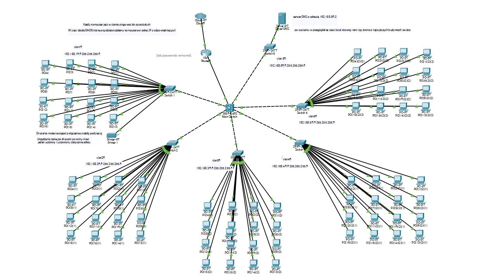
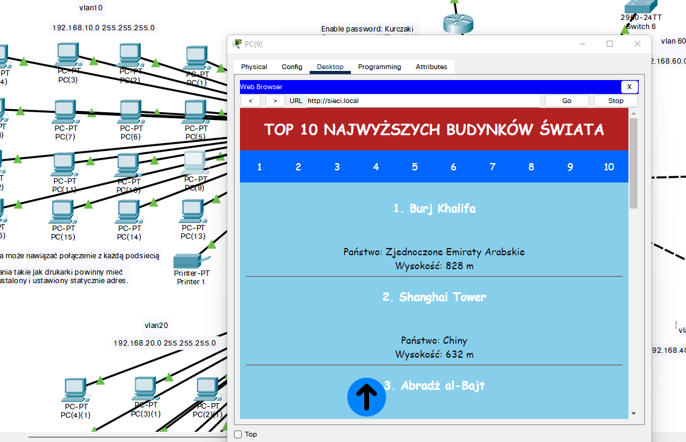
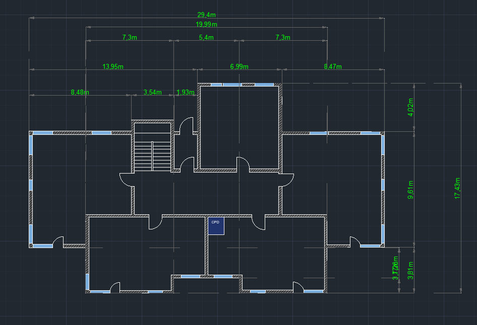
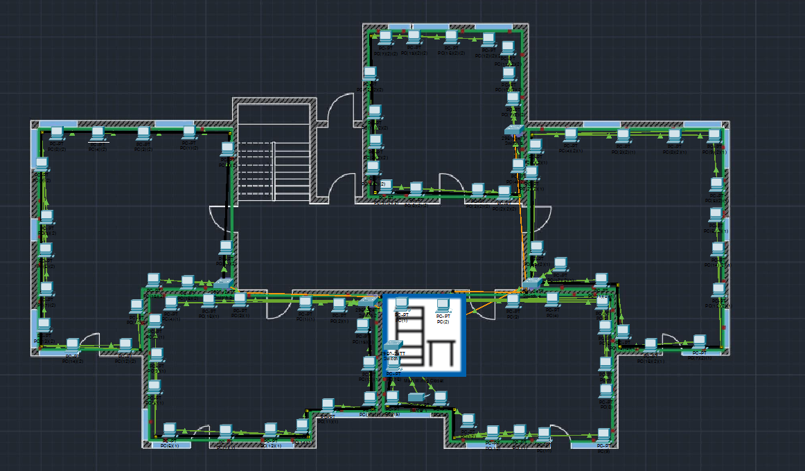
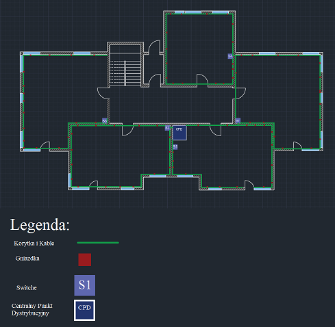
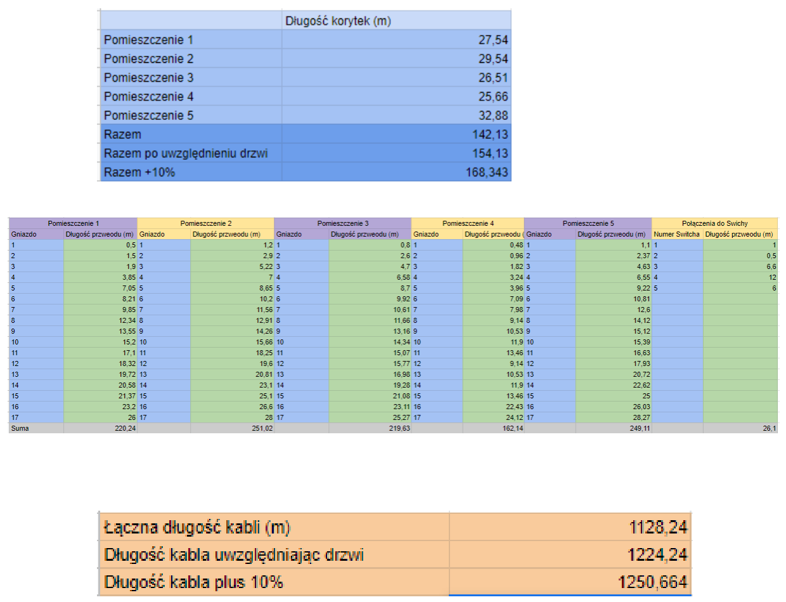
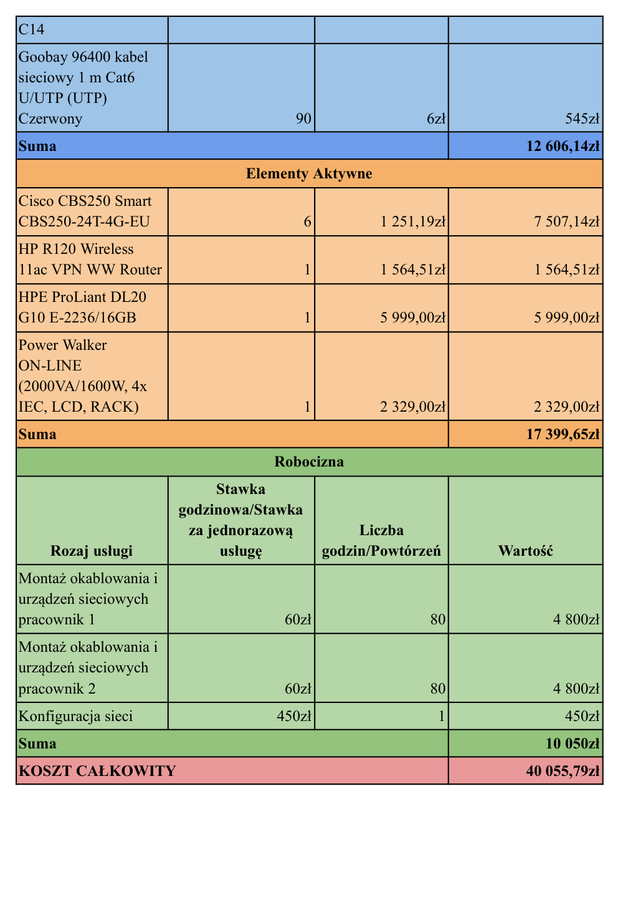
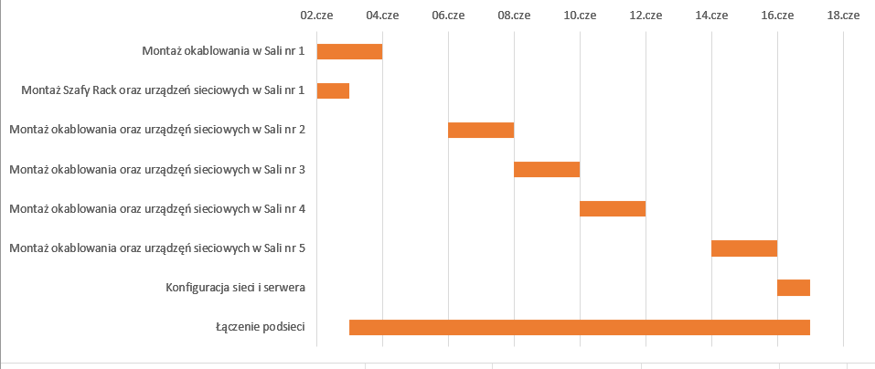

# School Network Design

A complete network design for five computer labs on one floor of a secondary school, prepared by **Szymon Baran** as a technical-school project. It covers user requirements, structured cabling, a VLAN-based logical design simulated in Cisco Packet Tracer, the physical layout on the floor plan, patch-panel documentation, equipment selection, a work schedule and a cost estimate.

| | |
| --- | --- |
| **Type** | Technical-school design project (IT technician programme), individual |
| **Scope** | One floor, five labs, 358.6 m², 80 workstations, one printer, one server |
| **Tools** | Cisco Packet Tracer, floor-plan drawing, spreadsheet estimates |
| **Result** | 42-page design document in Polish: [`docs/school-network-design-pl.pdf`](docs/school-network-design-pl.pdf) |
| **Historical estimate** | PLN 40,055.79 gross, including equipment, cabling and labour |

**Contents:** [Requirements](#requirements) · [Logical design](#logical-design) · [Physical design](#physical-design) · [Equipment and cost](#equipment-and-cost) · [Schedule](#schedule) · [Design review](#design-review) · [Validation status](#validation-status)

## Requirements

The brief describes a school with an IT technician programme. The network is on one floor with five labs, a corridor and a staircase.

- At least 16 workstations in each of the five labs.
- Internet access, a network printer and file exchange between computers.
- A DNS server and an internal school website reachable from every computer.
- A domain account for every student and teacher, e-mail and access to education platforms.
- A 19-inch rack in one lab holding the server, the main switch, the router and a UPS.
- Wired network only; Wi-Fi was not required.

## Logical design

The Packet Tracer model uses an extended star: a central multilayer switch (Cisco 3650-24PS) connects six access switches (Cisco 2960-24TT) and the router (Cisco 1841), which connects to the internet. Each lab is its own VLAN and subnet; the server has a separate VLAN.

| VLAN | Subnet | Location | Notes |
| --- | --- | --- | --- |
| 10 | `192.168.10.0/24` | Lab 1 | Rack room; the network printer has a static address |
| 20 | `192.168.20.0/24` | Lab 2 | |
| 30 | `192.168.30.0/24` | Lab 3 | |
| 40 | `192.168.40.0/24` | Lab 4 | |
| 50 | `192.168.50.0/24` | Lab 5 | |
| 60 | `192.168.60.0/24` | Rack in lab 1 | Server, DNS and intranet at `192.168.60.2` |

- **DHCP** gives each computer an address from its lab's pool; the printer has a fixed address.
- **DNS** on the server resolves the internal name `sieci.local`, which opens the school intranet page in a browser.
- **Inter-VLAN routing** lets every computer reach every other host, as the brief requires.
- **Gigabit Ethernet** (1000BASE-T) to every workstation.
- The router is protected with enable and secret passwords. The lab passwords visible in the original drawings have been removed from this repository's images and PDF.

## Physical design

The floor plan gives the room areas: 54.7, 54.8, 64.7, 44.3 and 64.6 m². The physical design places the network on it:

- **One main distribution point** in lab 1: 19-inch rack, router, main switch, server, UPS and a 24-port patch panel.
- **Five smaller distribution points**, one per lab: a wall-mounted rack, an access switch and a 24-port patch panel, placed as close to the main point as possible.
- **17 outlets per lab**: 16 workstations plus a spare for changes, faults or the printer, spaced so each user has at least 2 m².
- **Cable trunking at 60 cm** above the floor, below the window sills (80 cm), routed over eight doors.
- **Category 6 U/UTP** horizontal cabling, RJ45 surface-mounted outlets and Cat6 patch cords.
- A **patch-panel table** maps every panel port to its room and outlet number.

| Physical topology | Cable routes |
| --- | --- |
|  |  |

### Cable estimate

Cable length was measured for every outlet along the trunking route, per lab, plus the links between the switches, then adjusted:

- **Doors:** trunking is routed over eight doors (2.1 m high, trunking at 0.6 m), and outlets behind a door need longer runs, so the document adds a door allowance.
- **Margin:** 10% for measurement errors, cuts and waste.

| | Trunking | Cable |
| --- | --- | --- |
| Measured | 142.13 m | 1,128.24 m |
| With door allowance | 154.13 m | 1,224.24 m |
| Final figure in the document | 168.34 m | 1,250.66 m |

The order covers the cable with four 305 m boxes of Cat6 U/UTP and one 50 m Cat6a cable (1,270 m), and the trunking with 84 two-metre sections (168 m). The final figures contain a calculation error, described in the [design review](#design-review).

## Equipment and cost

| Item | Qty | Purpose |
| --- | --- | --- |
| Cisco CBS250-24T-4G | 6 | Managed L2/L3 switches |
| HP R120 router | 1 | Internet access and routing |
| HPE ProLiant DL20 Gen10 (Xeon E-2236, 16 GB) | 1 | DNS, intranet and file services |
| PowerWalker 2000 VA online UPS, rack | 1 | Power protection in the main rack |
| Racks, patch panels, trunking, outlets, cable, patch cords | — | Passive cabling |

| Cost group | Amount (PLN gross) |
| --- | --- |
| Cabling and installation materials | 12,606.14 |
| Active equipment | 17,399.65 |
| Labour: 2 installers × 80 h at PLN 60/h, plus configuration PLN 450 | 10,050.00 |
| **Total** | **40,055.79** |

Prices come from Polish retailers at the time of the project. They are historical and not current quotes. Operating systems and software licences are not included.

## Schedule

Work runs from 2 to 16 June: about 16 hours of cabling per lab, 10 working days of installation and one day of configuration, 88 hours in total.

## Design review

Reviewing the document for this portfolio, I found these gaps. The original document is kept as it was:

- **The Packet Tracer model and the purchase list do not match.** The simulation uses a Cisco 3650 core switch, seven switches and a Cisco 1841 router. The estimate buys six CBS250 switches and an HP R120 wireless router. A design should name one set of equipment and simulate that.
- **The switch count does not add up.** The model has a main switch, five lab switches and a server switch (seven), but the estimate has six switches.
- **A wireless router was chosen for a wired-only brief.** The HP R120 is a Wi-Fi router, while the requirements explicitly exclude Wi-Fi.
- **Inter-VLAN traffic is unrestricted.** Every computer can reach every other host, including the server VLAN. The VLANs organise the network, but there are no ACLs, so they do not separate students from the server or labs from each other.
- **Default gateways and the routing method are not documented.** The address table gives only the network and mask for each VLAN. Gateway addresses, DHCP pools and whether routing happens on the core switch or on the router (router-on-a-stick) should be stated.
- **The central point is a single point of failure.** One core switch, one uplink per lab and one UPS for the main rack only; the five lab switches have no backup power.
- **Some requirements are not designed.** Domain accounts, e-mail and the intranet's content management are listed as needs, but the design only covers DNS and the web page.
- **The `.local` domain** conflicts with multicast DNS and should be replaced by a subdomain of the school's real domain.
- **The 10% margin is calculated incorrectly.** The final cable figure adds 10% of 1,224.24 m to 1,128.24 m, so the door allowance is lost. The correct value is 1,224.24 m × 1.1 = **1,346.66 m**, about 77 m more than the 1,270 m ordered. The trunking has the same problem (168.34 m instead of 169.54 m), and the 12 m door allowance in the trunking table does not match the 24 m described in the text (8 doors × 3 m).
- **Theory errors.** The document describes 1000BASE-CX as using coaxial cable; it uses shielded balanced copper (twinax).

## Validation status

The Packet Tracer model shows DHCP addressing, name resolution of `sieci.local` and connectivity between labs. The `.pkt` file is not included in this repository, so the model cannot be reopened here. The cabling, equipment and costs are a design exercise; the network was not installed.

The next step would be a corrected design with one consistent equipment list, a full addressing plan with gateways and DHCP pools, ACLs between VLANs and a reachability matrix showing which segments may communicate.

## Project document

The full Polish design document is in [`docs/school-network-design-pl.pdf`](docs/school-network-design-pl.pdf). It contains the requirements analysis, standards for structured cabling, transmission media, logical and physical topology, VLAN descriptions, patch-panel tables, cable calculation, distribution points, equipment specifications, schedule and cost estimate. The only change from the original is the removal of lab passwords from three topology drawings.
